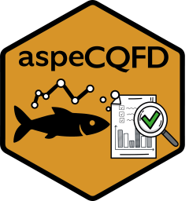

<!-- README.md is generated from README.Rmd. Please edit that file -->

```{r, include = FALSE}
knitr::opts_chunk$set(
  collapse = TRUE,
  comment = "#>",
  out.width = "100%"
)
```

<!-- badges: start -->
[](https://github.com/richaben/aspeCQFD/actions/workflows/R-CMD-check.yaml)
<!-- badges: end -->

## aspeCQFD - aspe <ins>C</ins>ontrôle <ins>Q</ins>ualité <ins>F</ins>iches <ins>D</ins>onnées <a href="https://richaben.github.io/aspeCQFD/"></a>

L'objectif du package {aspeCQFD} est de pouvoir créer des fiches de synthèse sur les informations bancarisées dans la base ASPE afin de pouvoir aider aux contrôles et validations.

## Installation 💻

La version en développement du package {aspeCQFD} est disponbile sur [GitHub](https://github.com/) avec la commande suivante :

``` r
# install.packages("pak")
pak::pak("richaben/aspeCQFD")
```

## Documentation 📚

Vignettes de documentation :

- [Créer des fiches CQ pour des stations](https://richaben.github.io/aspeCQFD/articles/creation-fiche-cq.html)
- [Détails du contenu des fiches CQ stations](https://richaben.github.io/aspeCQFD/articles/details-fiche-cq.html)

